<div align="center">

# Agrim

### Flood early warning for Gurugram's waterlogging hotspots

**IMD forecasts rain. Agrim forecasts *which junction floods*, how sure it is, and what each crew should do, 24–48 hours before the rain.**

[](https://github.com/varuntutejaa/Agrim/actions/workflows/ci.yml)
[](https://agrim-two.vercel.app)
[](https://agrim-api.onrender.com/docs)
[](#roadmap)
[](#)


[**Open the live app**](https://agrim-two.vercel.app) · [API reference](#api-reference) · [Architecture](#architecture) · [Demo script](docs/DEMO_SCRIPT.md) · [Data requirements](docs/DATA_REQUIREMENTS.md)

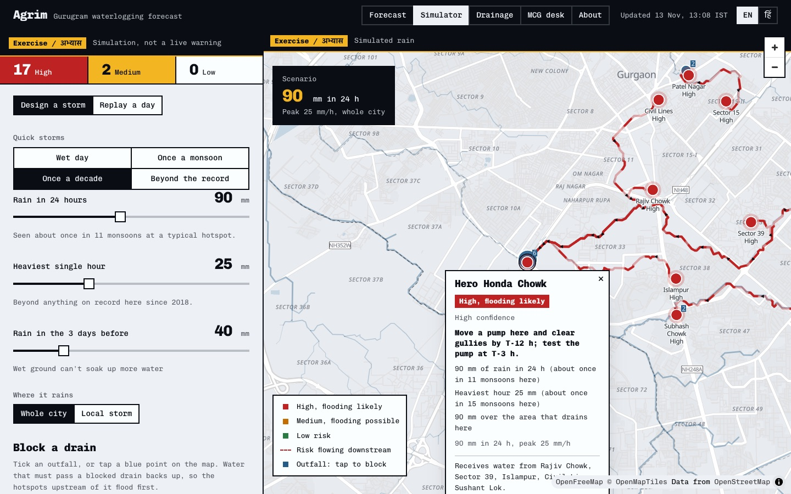

</div>

---

## Contents

- [Why Agrim](#why-agrim)
- [What it does](#what-it-does)
- [Architecture](#architecture)
- [How the risk is calculated](#how-the-risk-is-calculated)
- [Tech stack](#tech-stack)
- [Getting started](#getting-started)
- [Configuration](#configuration)
- [API reference](#api-reference)
- [Data model](#data-model)
- [Data and honesty](#data-and-honesty)
- [Deployment](#deployment)
- [Operations runbook](#operations-runbook)
- [Testing](#testing)
- [Security and privacy](#security-and-privacy)
- [Repository layout](#repository-layout)
- [Roadmap](#roadmap)
- [Documentation](#documentation)
- [Author](#author)

---

## Why Agrim

Every monsoon, the same Gurugram junctions go under water: Hero Honda Chowk, Narsinghpur, Subhash Chowk, Sohna Road. The Municipal Corporation of Gurugram (MCG) already watches 155 waterlogging points round the clock, but it learns which ones flooded **after** the water arrives.

Rain forecasts exist. What's missing is the step from *"80 mm expected"* to *"move a pump to Hero Honda Chowk by 1 am; Sector 39 will be fine"*.

| | Today | With Agrim |
|---|---|---|
| **Question answered** | Will it rain in Gurugram? | Which of the hotspots will flood, when, and how sure are we? |
| **Granularity** | City / district | Each hotspot, with the area that drains into it |
| **Output** | A forecast map | A ranked list, SOP orders per zone, crew SMS, citizen alerts in Hindi and English |
| **Feedback loop** | None | Officer overrides and after-rain reports feed a scorecard and the model |

---

## What it does

<table>
<tr>
<td width="50%" valign="top">

**Forecast**: the public view
Live rain from three weather models (ECMWF, GFS, ICON), turned into **High / Medium / Low** (Red / Amber / Green) for each hotspot for the next 24 h and day 2. **Confidence is model agreement**: all three show flooding = likely, one or two = possible, shown as three squares on every hotspot. Three plain-language reasons each, English and **Hindi**, a "roads to avoid" list, and a warning when the forecast is over 12 h old. Built for phones.

</td>
<td width="50%">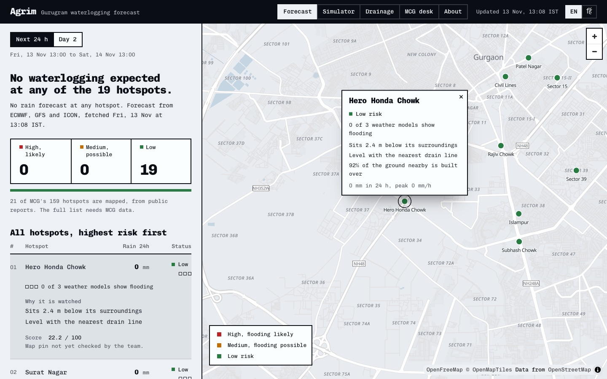</td>
</tr>
<tr>
<td valign="top">

**Simulator**: for drills and the jury
Design a storm (whole city, or a local storm placed by tapping the map) or replay any monsoon day since 2018. **Block a drain** and watch the hotspots that drain through it back up: blocking the Hero Honda Chowk outfall turns 6 hotspots Red at 40 mm. Flow paths turn red and move, showing **risk travelling downstream**. Always marked **EXERCISE / अभ्यास**.

</td>
<td>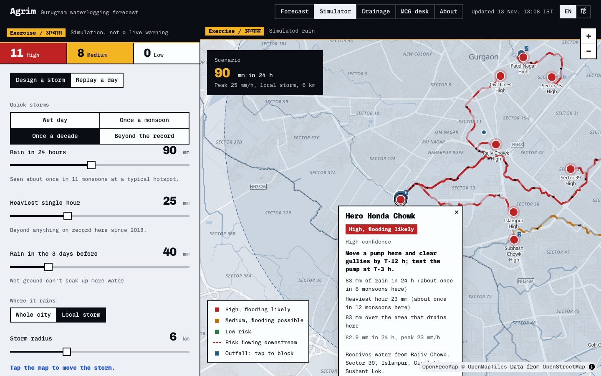</td>
</tr>
<tr>
<td valign="top">

**Drainage**: how water moves
A drainage network computed from 30 m elevation data and mapped drains: catchments and flow paths between hotspots. **Critical points** ranks outfalls by hotspots served: Hero Honda Chowk's serves **6 of 19**, and 8 outfalls cover 84%, as a list, a coverage curve and a map layer. An optional layer shows **proposed sensors** (25 rain gauges, 43 drain sensors, 8 underpass monitors; illustrative). Water runs north-west toward the Najafgarh drain, the gradient the Centre described in the Lok Sabha.

</td>
<td>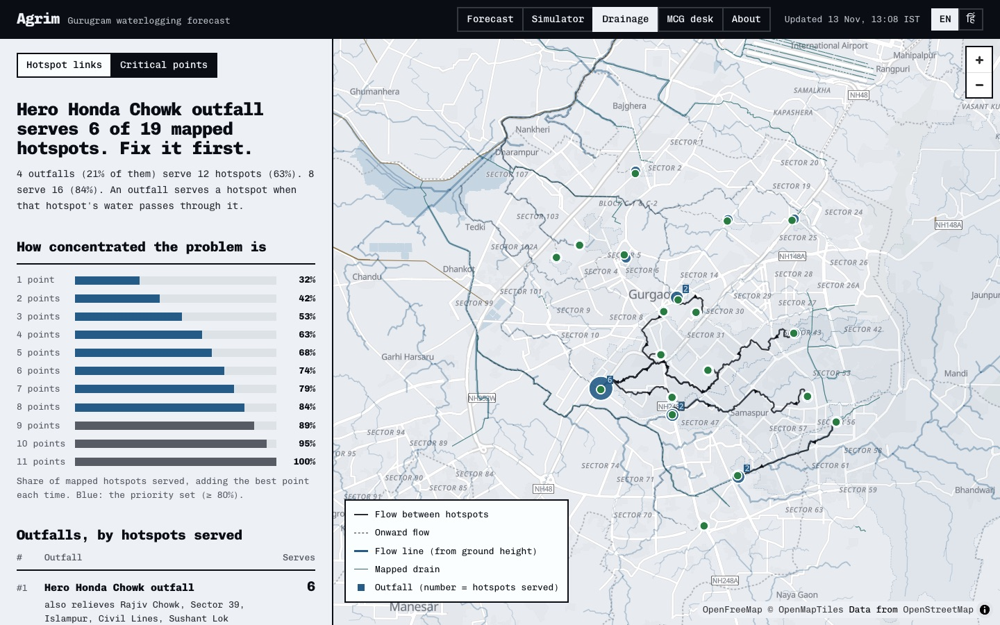</td>
</tr>
<tr>
<td valign="top">

**MCG desk**: operations
The SOP as a timeline (T-24 orders, T-12 gullies and pumps, T-3 pump test, T+24 report), ticks per hotspot, **officer overrides with a reason**, order sheets and crew SMS per zone, officer-approved **citizen alerts**, after-rain reports and a **scorecard**. Live or exercise mode.

</td>
<td>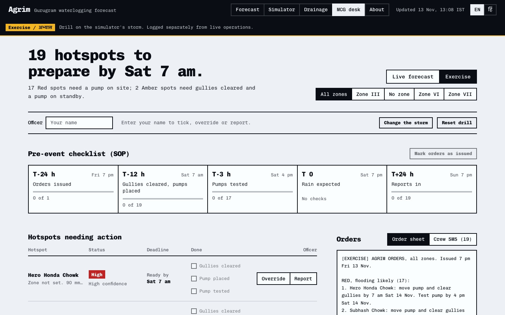</td>
</tr>
<tr>
<td valign="top">

**About**: assumptions, in the open
A one-screen landing page leads in. The About area holds the **backtest** on past floods (published once the news reports are reviewed), the **public override log** (place, date, reason; no officer names), data and assumptions (what MCG's unreleased data would add, with evidence it exists), and **sources & credits**.

</td>
<td>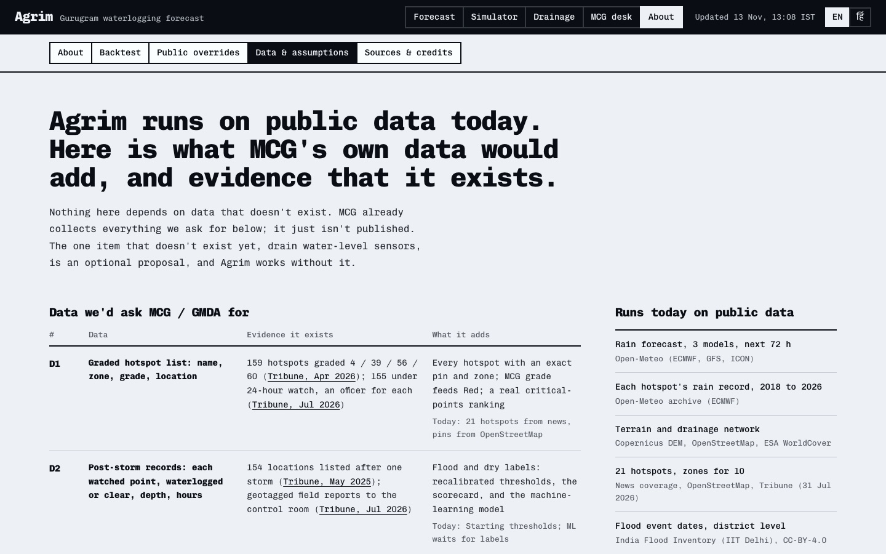</td>
</tr>
</table>

<details>
<summary><b>More screenshots</b>: past-day replay, citizen alerts, Hindi on a phone</summary>

| Replay a past day | Citizen alerts (EN + HI, mock IVR) | Hindi on a phone |
|---|---|---|
| 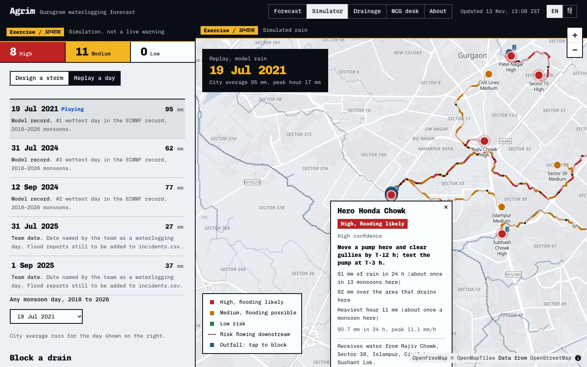 | 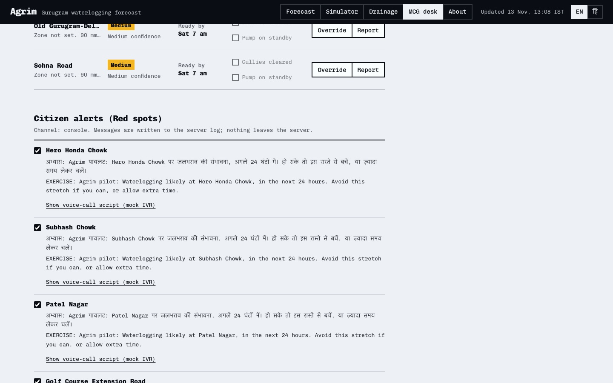 | 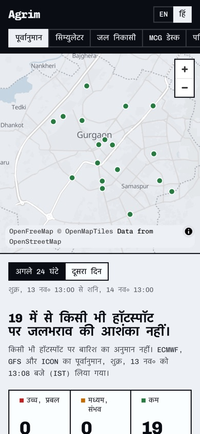 |

</details>

---

## Architecture

### System overview

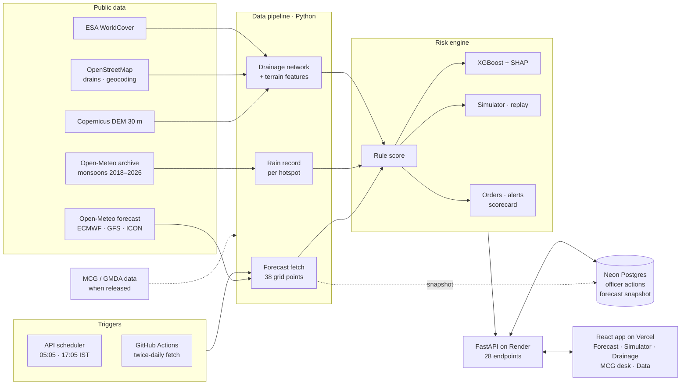

### What happens when someone opens the app

The free server sleeps when idle and loses its disk on restart, and Open-Meteo sometimes refuses Render's shared address. So the API always tries the cheapest source first and never leaves the page blank.

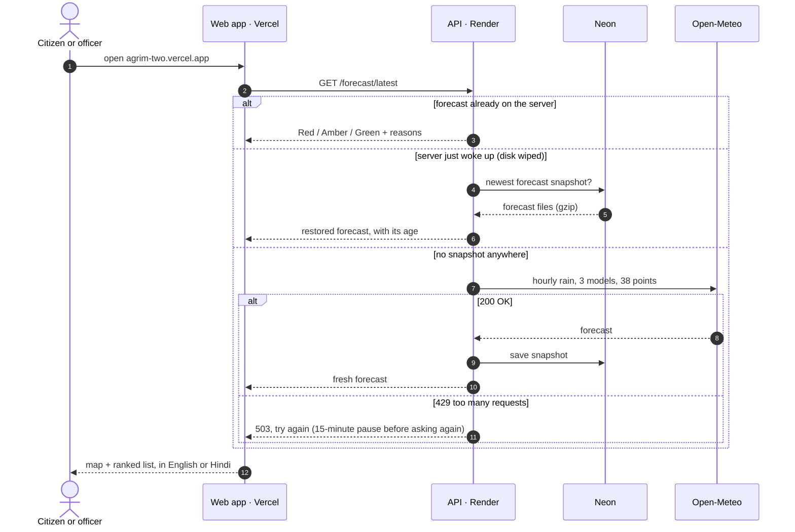

### Drainage network build

```mermaid
flowchart LR
  A["Copernicus DEM<br/>30 m, UTM 43N"] --> B["Carve OSM drains<br/>5 m deep<br/>(not canals)"]
  B --> C["Fill pits and depressions<br/>tilt flat areas<br/>repeat until none undrained"]
  C --> D["D8 flow direction<br/>+ accumulation"]
  D --> E["Snap each hotspot to the<br/>nearest flow line ≤ 150 m"]
  E --> F["Upstream catchment<br/>per hotspot"]
  F --> G["Link A → B if A's flow path<br/>passes within 150 m of B"]
  G --> H["Keep direct links only<br/>(transitive reduction)"]
  H --> I["Critical points ranking<br/>+ terrain features"]
```

### Officer-approved citizen alerts

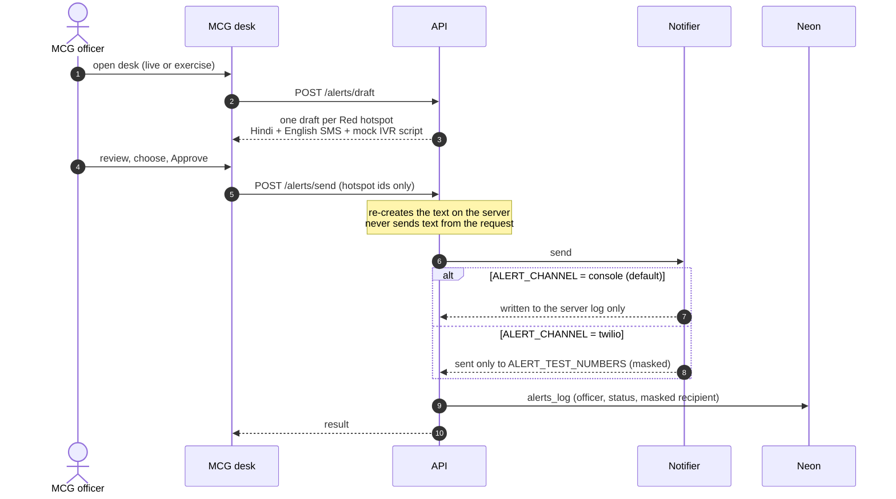

### The SOP Agrim drives

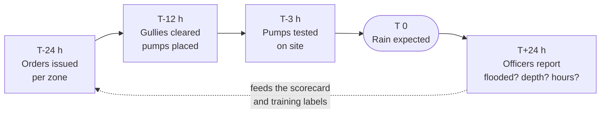

---

## How the risk is calculated

Global weather models under-read short cloudbursts. In ECMWF's 2018–2026 record over Gurugram, daily rain crossed IMD's "heavy" mark on only 2 of 1,098 monsoon days. So Agrim never compares model rain with gauge thresholds. It compares each forecast with **the same model's own record at that hotspot** ("wetter than 99% of monsoon hours here"), then adds terrain.

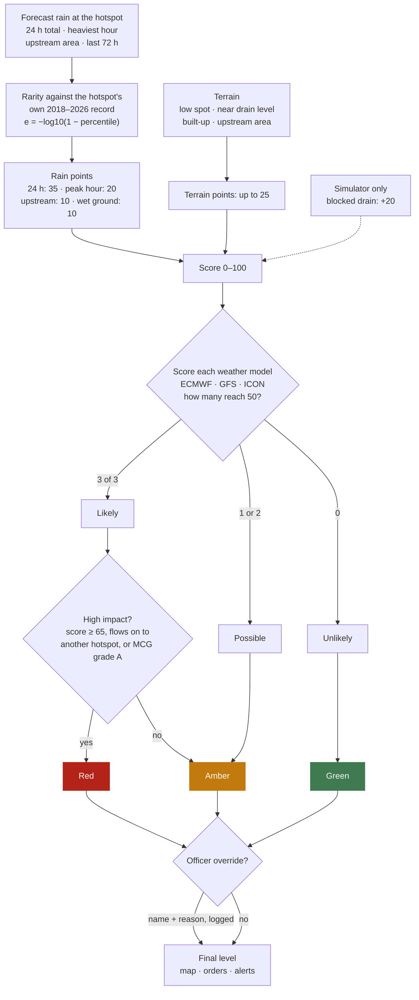

- **Confidence is model agreement.** Live forecasts are scored once per weather model, and the vote sets the outlook (above). The simulator has one rain value, so there it scores rain × 0.7 / × 1.0 / × 1.4 instead.
- **Two tiers.** The rules work with zero flood records. The **XGBoost** model (Tier B) trains only on real labels (sourced reports plus officer reports), refuses to train below 30 usable labels (at least 8 floods and 8 dry cases), and is checked one storm date at a time against the rules. Its SHAP explanations come from XGBoost itself, so the server stays light.
- **Starting values, stated plainly.** The thresholds aren't fitted to past floods yet, and the app says so. Full details: [docs/MODEL.md](docs/MODEL.md).

<details>
<summary><b>An honest check: the rules against 39 news-reported floods</b></summary>

Unreviewed news reports of floods at mapped hotspots (9 storm days, 2020–2025), scored with the rule set on that day's recorded rain:

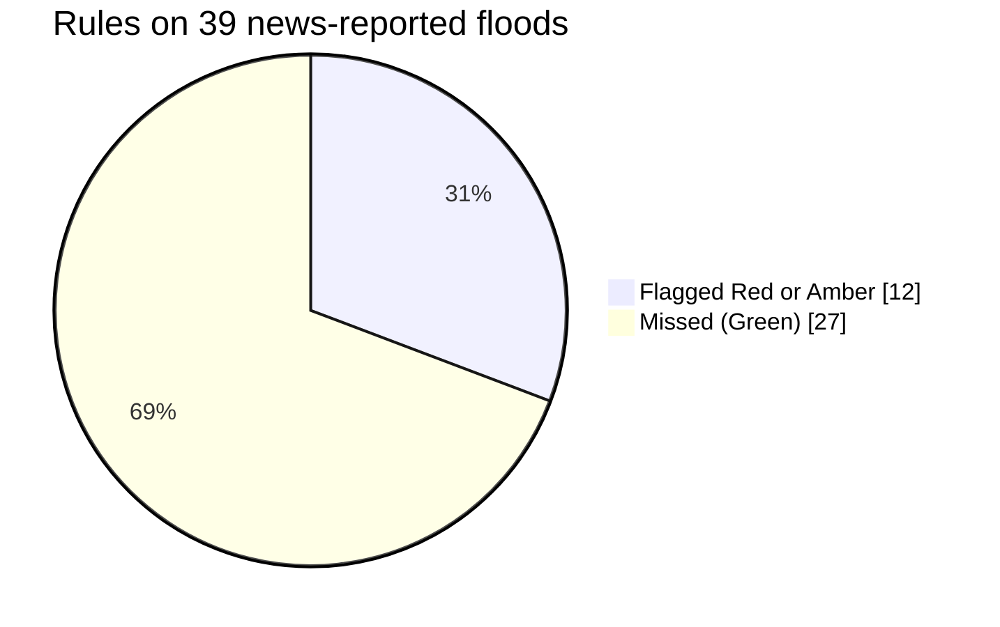

Every miss was a day the forecast model under-read the rain: 7 where it saw little rain, 20 moderate, none extreme. For example, on 9 Jul 2023 the model shows 12–21 mm, while reports give 150 mm. The app's **About → Backtest** page lists each flood and why it was missed, and goes live only after a person has reviewed the reports. That's why **rain-gauge data is the first thing Agrim asks MCG for** ([D3 in the data requirements](docs/DATA_REQUIREMENTS.md)).

</details>

---

## Tech stack

| Layer | Choice | Why |
|---|---|---|
| Frontend | React 19, Vite, TypeScript, Tailwind CSS v4, MapLibre GL | Fast static build, vector map with no API key |
| Design | Chivo Mono + IBM Plex Sans Devanagari, self-hosted; OKLCH tokens | Reads like public signage: a board you can read at a glance; Hindi-ready ([docs/DESIGN.md](docs/DESIGN.md)) |
| API | FastAPI, Uvicorn, APScheduler | Typed endpoints, OpenAPI docs, scheduled runs |
| Storage | Neon Postgres (psycopg 3, pooled) | Officer actions, alert log, forecast snapshot |
| Geo pipeline | rasterio, pysheds, geopandas, shapely, networkx | DEM conditioning, flow routing, the hotspot graph |
| Model | Rule score + XGBoost (CPU build on Linux), SHAP via `pred_contribs` | Works today; learns once labels exist |
| Hosting | Render (API, Ohio), Vercel (web), GitHub Actions (CI + forecast job) | Free tiers, one public URL |

---

## Getting started

### Prerequisites

Python **3.11**, Node **20+**, and optionally a Neon (or any Postgres) connection string for the MCG desk.

### Quick start

```bash
git clone https://github.com/varuntutejaa/Agrim.git && cd Agrim

# API
python3.11 -m venv .venv && source .venv/bin/activate
pip install -r requirements-pipeline.txt      # API only: requirements.txt
cp .env.example .env                           # add DATABASE_URL for the MCG desk
uvicorn api.main:app --reload --port 8000      # docs at http://localhost:8000/docs

# Web (second terminal)
cd web && npm install && cp .env.example .env.local
npm run dev                                    # http://localhost:5173
```

The committed data (`data/hotspots.csv`, `data/network/`, `data/model/`) is enough to run everything. On the first request the API fetches a forecast by itself.

> **macOS:** XGBoost needs an OpenMP library. Run `./scripts/fix_xgboost_macos.sh` once; it borrows scikit-learn's copy, so Homebrew isn't needed.

<details>
<summary><b>Rebuild all data from scratch</b> (pipeline commands)</summary>

```bash
# Hotspots and rain
python -m pipeline.geocode_hotspots          # data/hotspots.csv (never overwrites checked pins)
python -m pipeline.fetch_rain_forecast       # 3 models, the grid points hotspots use
python -m pipeline.fetch_rain_history        # Jun–Sep 2018 to now, each hotspot

# Terrain and drainage network (docs/NETWORK.md)
python -m pipeline.fetch_dem
python -m pipeline.fetch_landcover
python -m pipeline.fetch_osm
python -m pipeline.build_network             # re-run when hotspots.csv changes

# Risk model (docs/MODEL.md)
python -m model.climatology                  # each hotspot's rain record
python -m model.replay                       # past days for the simulator
python -m model.run_forecast --fetch         # data/forecast/latest_risk.json
python -m model.train                        # Tier B, once labels exist

# Labels and MCG data
python -m pipeline.add_incident              # one sourced report
python -m pipeline.review_candidates         # accept/reject the 48 news candidates
python -m pipeline.fetch_ifi                 # India Flood Inventory, Gurugram events
python -m pipeline.import_mcg hotspots FILE  # MCG's hotspot list (templates in data/templates/)
python -m pipeline.import_mcg storm-reports FILE --reference "MCG letter …"
```

</details>

---

## Configuration

All secrets live in `.env` (gitignored) locally, and in each host's environment settings in production. Never commit them.

| Variable | Where | Default | Purpose |
|---|---|---|---|
| `DATABASE_URL` | API, GitHub secret | – | Neon Postgres. Enables the MCG desk, alert log, scorecard and forecast snapshot |
| `SCHEDULER` | API | `off` | `on` = runs at 05:05 and 17:05 IST, hourly while anything is Red/Amber |
| `CORS_ORIGINS` | API | – | Extra allowed web origins (the live site is built in) |
| `RUN_TOKEN` | API | – | If set, `POST /forecast/run` needs `x-agrim-token` |
| `OPS_TOKEN` | API | – | If set, desk actions need a desk code (`x-agrim-desk`) |
| `ALERT_CHANNEL` | API | `console` | `console` (server log only) or `twilio` |
| `ALERT_TEST_NUMBERS` | API | – | The only numbers Twilio may text (your own test phones) |
| `TWILIO_ACCOUNT_SID` / `TWILIO_AUTH_TOKEN` / `TWILIO_FROM` | API | – | Twilio sandbox credentials |
| `NOMINATIM_CONTACT` | Pipeline | – | Contact added to the OpenStreetMap User-Agent |
| `AGRIM_DB_SCHEMA` | Tests | `public` | Throwaway schema for database tests |
| `VITE_API_URL` | Web build | `http://localhost:8000` | API address baked into the web build |

---

## API reference

Interactive docs: **[agrim-api.onrender.com/docs](https://agrim-api.onrender.com/docs)**. Access: **public** = open; **desk** = needs the desk code when `OPS_TOKEN` is set; **run** = needs `RUN_TOKEN` when set. Writes always need `DATABASE_URL`.

| Group | Method & path | Access | What it returns / does |
|---|---|---|---|
| Status | `GET /health` | public | Up? How old is the forecast? |
| Forecast | `GET /forecast/latest` | public | Red/Amber/Green per hotspot (24 h + day 2), confidence, reasons, action, overrides applied |
| | `POST /forecast/run` | run | Re-score now; `{"fetch": true}` downloads a fresh forecast (10-minute cooldown) |
| Map layers | `GET /hotspots` | public | Hotspots as GeoJSON |
| | `GET /rain/latest` | public | Rain per grid point: past 72 h, next 24/48 h, peak hour |
| | `GET /network` · `/network/catchments` · `/network/streams` · `/network/drains` | public | Drainage graph, catchments, flow lines, mapped drains |
| | `GET /network/critical` | public | Outfalls ranked by hotspots served, the 80% priority set, the coverage curve |
| | `GET /sensors/proposed` | public | Proposed sensor sites (illustrative, `is_synthetic`) |
| Simulator | `POST /simulate` | public | Same rules on a designed storm or a past day (always an exercise); `blocked: [outfall ids]` blocks drains |
| | `GET /simulate/events` · `/simulate/dates` | public | Curated replays · every monsoon day on record |
| MCG desk | `GET /orders/{zone}` · `POST /orders/exercise` | public | Order sheet + crew SMS per zone (`all` for every zone) |
| | `POST /override` · `POST /override/{id}/revoke` · `GET /overrides` | desk · desk · public | Officer overrides (name + reason, expiry), and the log |
| | `GET /overrides/public` | public | Public override log: place, date, model's call, new call, reason (no officer names, no drills) |
| | `POST /feedback` · `GET /feedback` | desk · public | After-rain reports |
| | `GET /checklist` · `POST /checklist` | public · desk | SOP ticks per forecast run |
| | `POST /exercise/reset` | desk | Clear drill ticks and overrides |
| Alerts | `GET /alerts/public` | public | "Roads to avoid" in English and Hindi |
| | `POST /alerts/draft` | public | Citizen SMS (HI + EN) and a mock IVR script per Red hotspot |
| | `POST /alerts/send` · `GET /alerts/log` | desk · public | Officer-approved send through the configured channel; the log |
| Model | `GET /model/status` · `GET /scorecard` | public | Tier B status and checks · hits, misses, false alarms, override outcomes |
| | `GET /backtest` | public | Rules against reviewed past floods: caught or missed, and why (`candidates_pending` until reviewed) |

<details>
<summary><b>Examples</b></summary>

```bash
API=https://agrim-api.onrender.com

# Today's forecast
curl -s $API/forecast/latest | jq '.meta.counts.next_24h'

# A once-a-decade storm centred on Hero Honda Chowk
curl -s -X POST $API/simulate -H 'content-type: application/json' \
  -d '{"mode":"storm","rain_24h":90,"peak1h":25,"past_72h":40,"centre":[77.01,28.436],"radius_km":4}' \
  | jq '.meta.counts'

# Same storm, with Hero Honda Chowk's outfall blocked
curl -s -X POST $API/simulate -H 'content-type: application/json' \
  -d '{"mode":"storm","rain_24h":40,"peak1h":12,"past_72h":30,"blocked":["N01"]}' \
  | jq '.meta.counts'

# Replay the wettest day in the record
curl -s -X POST $API/simulate -H 'content-type: application/json' \
  -d '{"mode":"replay","date":"2021-07-19"}' | jq '.meta.event.note'

# Drill orders for every zone
curl -s -X POST $API/orders/exercise -H 'content-type: application/json' \
  -d '{"rain_24h":90,"peak1h":25,"past_72h":40}' | jq -r '.text'
```

</details>

---

## Data model

Officer actions live in Postgres. Hotspots, terrain and the rain record are versioned files in `data/`.

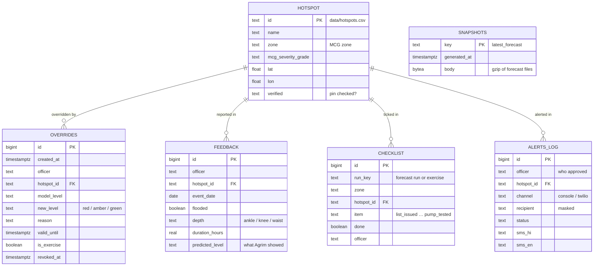

Tables are created on first use. Every query names its schema explicitly, so nothing depends on session settings that could leak through Neon's connection pooler.

---

## Data and honesty

The competition disqualifies fabricated data, and an early-warning system is only as good as its honesty. So:

- **Nothing shown as real is made up.** Simulated storms are labelled **EXERCISE / अभ्यास** and flagged `is_synthetic`. The machine-learning model will not train on invented floods.
- **Every source is cited** in [docs/SOURCES.md](docs/SOURCES.md): Open-Meteo (ECMWF, GFS, ICON, ERA5), Copernicus DEM, ESA WorldCover, OpenStreetMap, the India Flood Inventory (IIT Delhi), and named news reports.
- **The limits are stated in the app itself:** model rain under-reads cloudbursts, pins are unverified until checked, and thresholds are starting values.
- **Built to accept MCG's data.** It assumes only data MCG already holds, with evidence for each item:

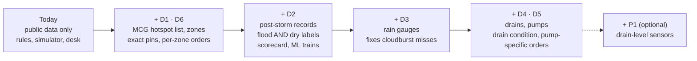

Each step, the evidence that the data exists, the import templates (`data/templates/`) and a draft data request to MCG are in [docs/DATA_REQUIREMENTS.md](docs/DATA_REQUIREMENTS.md), and in the app's **Data** tab.

---

## Deployment

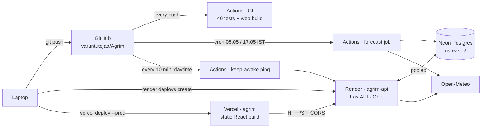

| Component | Where | How to release |
|---|---|---|
| API | Render web service `agrim-api` (free, Ohio, next to Neon) | `render deploys create srv-dbo2uqs9v7es73e5hl40` (config in `render.yaml`) |
| Web | Vercel project `agrim` → [agrim-two.vercel.app](https://agrim-two.vercel.app) | `cd web && vercel deploy --prod --build-env VITE_API_URL=https://agrim-api.onrender.com` |
| Database | Neon Postgres | Tables created automatically |
| Forecast refresh | Render scheduler + GitHub Actions job (05:05 / 17:05 IST) | Needs a `DATABASE_URL` repository secret (Settings → Secrets and variables → Actions) |
| Keep-awake | GitHub Actions, every 10 min, 06:30–23:30 IST, until 30 Nov 2026 | `.github/workflows/keep-awake.yml`; stops itself after the date |

Performance, measured on the live site with an emulated mid-range phone over 4G: the forecast headline appears in **3.9 s** on a first visit and **1.3 s** when cached (server awake).

---

## Operations runbook

| Symptom | Cause | Fix |
|---|---|---|
| First page load takes 30–60 s | Free Render instance was asleep (the keep-awake ping covers daytime until 30 Nov) | Open `/health` a couple of minutes before a demo |
| Masthead says "· old", amber banner on the forecast | Forecast over 12 h old: the refresh job isn't running | Check the `DATABASE_URL` secret, then run the **Forecast** workflow |
| "No forecast yet" (503) | Open-Meteo refused the server (429) and no snapshot exists | Locally: `python -m model.run_forecast --fetch && python -m api.snapshot push`, or run the **Forecast** workflow |
| Forecast is old | Server blocked from Open-Meteo | Same as above; the site keeps showing the last saved forecast with its time |
| Desk says "actions are off" | `DATABASE_URL` missing on the server | Add it in Render → agrim-api → Environment |
| Browser blocks API calls | Site address not allowed (CORS) | Add it to `CORS_ORIGINS` or the list in `api/main.py` |
| `import xgboost` fails on a Mac | OpenMP missing | `./scripts/fix_xgboost_macos.sh` |

<details>
<summary><b>Demo-day checklist</b></summary>

1. Open `https://agrim-api.onrender.com/health` 2 minutes before.
2. Open the app on the laptop and on a phone.
3. MCG desk → officer name → **Exercise** → **Reset drill**.
4. Simulator → **Once a decade**, whole city.
5. Keep `docs/screenshots/` open as an offline fallback.

The full 3-minute script is in [docs/DEMO_SCRIPT.md](docs/DEMO_SCRIPT.md).

</details>

---

## Testing

```bash
python -m pytest -q tests        # 40 tests
cd web && npm run build          # type-check + production build
```

- **Coverage:** the rules (no rain never floods, more rain never lowers risk, scenarios and levels), the simulator, the order sheets, alerts (wording, exercise labels, safe sending), MCG imports, the ML pipeline (refuses to train on too little data; trains, checks and explains on test-only labels), the forecast snapshot, model-agreement confidence, critical points, blocking a drain, the backtest's review gate and the proposed sensors.
- **Database tests** run against Neon in a throwaway schema that is dropped afterwards, and are skipped when `DATABASE_URL` isn't set.
- **CI:** [GitHub Actions](.github/workflows/ci.yml) runs the Python tests and the web build on every push.

---

## Security and privacy

- **No secrets in the repo.** `.env` is gitignored, and secrets are set per host.
- **Alerts are safe by default.** The console channel only writes a log. Twilio may text only `ALERT_TEST_NUMBERS` from the server's environment, never numbers from a request. Every send needs an officer's approval and is logged with masked numbers. The server re-creates the message text itself.
- **No impersonation.** Messages say "Agrim pilot" and never claim to come from MCG.
- **Optional access codes.** `OPS_TOKEN` (desk actions) and `RUN_TOKEN` (forced runs). Fetching from Open-Meteo has a cooldown, so the API can't be used to hammer the free service.
- **Minimal personal data.** Officer names on the actions they take, and nothing about citizens. Officer phone numbers, if MCG shares a roster, stay server-side and are never returned by the API.

---

## Repository layout

```text
Agrim/
├── api/                  FastAPI app
│   ├── main.py           routes (32 endpoints)
│   ├── data.py           map layers from pipeline files
│   ├── ops.py            overrides, reports, checklist, alert log, scorecard
│   ├── db.py             Neon Postgres (schema-qualified SQL)
│   ├── snapshot.py       forecast saved to and restored from the database
│   ├── scheduler.py      twice-daily runs, storm mode, fetch cooldown
│   └── notify.py         alert channels (console / Twilio sandbox)
├── model/                rules, climatology, simulator, replay, backtest, orders, alerts, XGBoost + SHAP
├── pipeline/             data fetchers, drainage network, critical points, proposed sensors, geocoding, imports, label tools
├── web/                  React + Vite + TypeScript + MapLibre + Tailwind
│   └── src/components/   Landing, Forecast, Simulator, Drainage + Critical points, MCG desk (ops/), About (about/)
├── data/
│   ├── hotspots.csv      hotspots (MCG schema: id, name, zone, grade, lat, lon)
│   ├── incidents.csv     sourced flood labels (empty until reviewed)
│   ├── incidents_candidates.csv   48 news-sourced candidates awaiting review
│   ├── network/          drainage outputs the API serves
│   ├── model/            rain record, replay days, model status
│   ├── external/         India Flood Inventory subset (CC-BY-4.0)
│   ├── templates/        header-only templates for MCG data
│   └── synthetic/        illustrative data only, flagged (proposed sensor sites)
├── docs/                 model, network, data requirements, SOP, design, sources, demo
├── tests/                40 tests
├── reference/jalnetra/   reference code from an earlier project (not run)
├── scripts/              macOS XGBoost helper
├── .github/workflows/    CI, twice-daily forecast job, daytime keep-awake ping
└── render.yaml           API deployment (Render)
```

---

## Roadmap

- [x] Hotspots geocoded, rain forecast and 2018–2026 record
- [x] Drainage network and critical intervention points
- [x] Rule-based risk score, Red / Amber / Green map
- [x] Simulator and past-day replay
- [x] MCG desk: orders, SOP checklist, overrides, reports
- [x] XGBoost + SHAP pipeline (ready, waiting for real labels)
- [x] Alerts (EN + HI, mock IVR), scorecard, Hindi, deployment, CI
- [x] Forecast snapshot in the database (survives restarts and throttling)
- [x] Confidence from three-model agreement on every hotspot
- [x] Critical points (list + map), block-a-drain simulation, proposed sensors (illustrative)
- [x] Landing page; About area with backtest, public override log, sources & credits
- [ ] Review the 48 news candidates into `data/incidents.csv`
- [ ] MCG data: hotspot list (D1), post-storm records (D2), rain gauges (D3)
- [ ] Recalibrate thresholds on reviewed outcomes; train Tier B
- [ ] Native-speaker review of the Hindi text
- [ ] Gauge-based bias correction and short-range nowcast

---

## Documentation

| Document | What's in it |
|---|---|
| [docs/MODEL.md](docs/MODEL.md) | Rule score, rarity, scenarios, levels, Tier B, the honest check |
| [docs/NETWORK.md](docs/NETWORK.md) | DEM conditioning, flow routing, links, terrain features, limits |
| [docs/DATA_REQUIREMENTS.md](docs/DATA_REQUIREMENTS.md) | Assumptions, MCG data requests with evidence, draft request |
| [docs/SOURCES.md](docs/SOURCES.md) | Every data source, licence and derived file |
| [docs/SOP.md](docs/SOP.md) | How the MCG desk maps to the monsoon SOP |
| [docs/DESIGN.md](docs/DESIGN.md) | Design tokens, typography, rules, language |
| [docs/DEMO_SCRIPT.md](docs/DEMO_SCRIPT.md) | The 3-minute demo, beat by beat |

---

## Author

**Varun Tuteja**: design, data pipeline, models, API, web app and deployment.
GitHub: [varuntutejaa](https://github.com/varuntutejaa)

### Data credits

Rain: [Open-Meteo](https://open-meteo.com) (ECMWF, NOAA GFS, DWD ICON, ERA5; CC BY 4.0) · Elevation: Copernicus DEM GLO-30 (© DLR / Airbus, provided under COPERNICUS by the EU and ESA) · Land cover: ESA WorldCover 2021 (CC BY 4.0) · Drains, roads and geocoding: © OpenStreetMap contributors (ODbL) · Basemap: OpenFreeMap / OpenMapTiles · Flood events: India Flood Inventory, IIT Delhi (CC BY 4.0).

### License

No open-source licence has been chosen yet. Until one is added, all rights are reserved by the author.

<div align="center">
<sub>Agrim · SustainX 2026 · Gurugram</sub>
</div>
